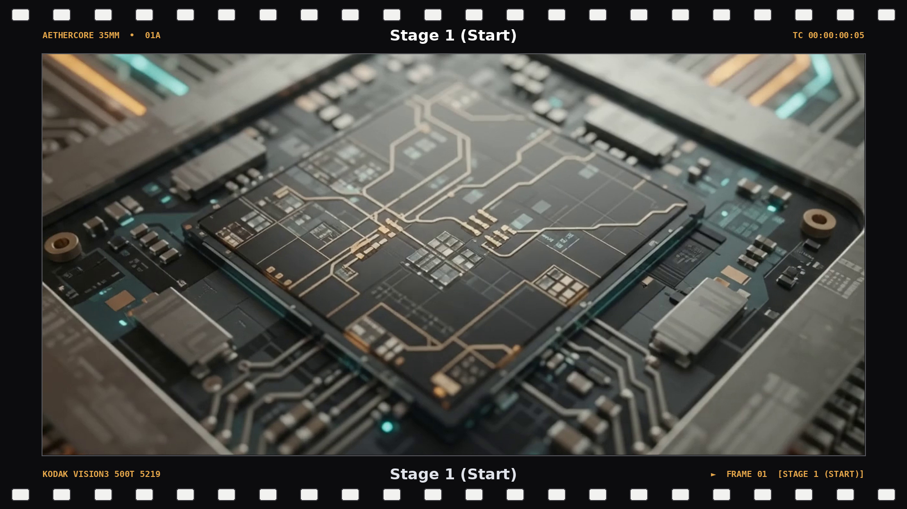
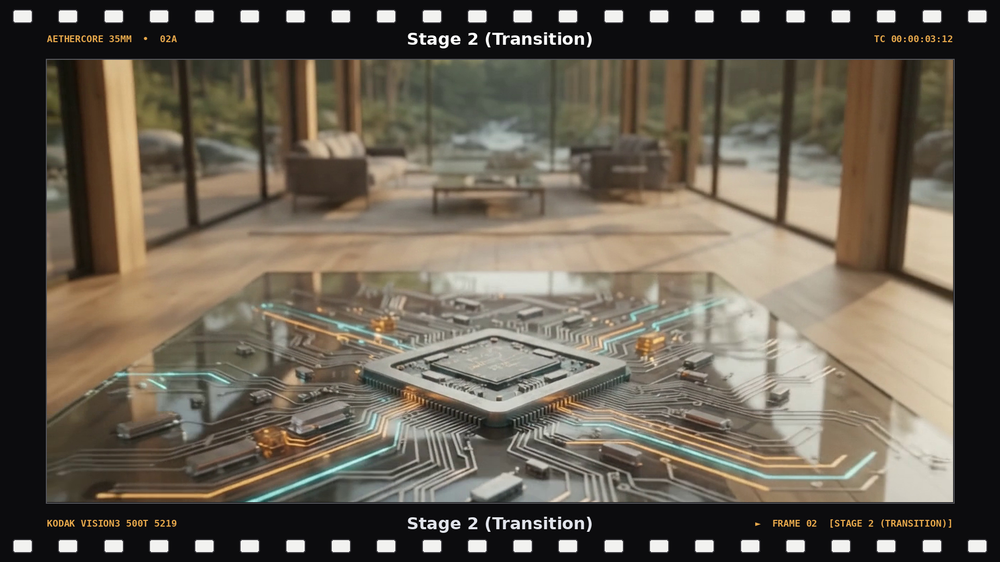
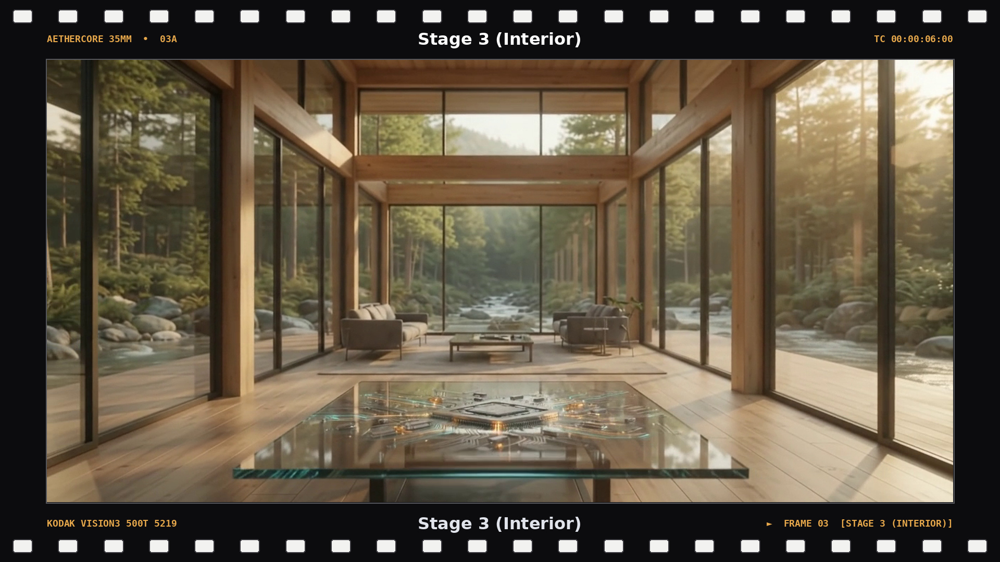
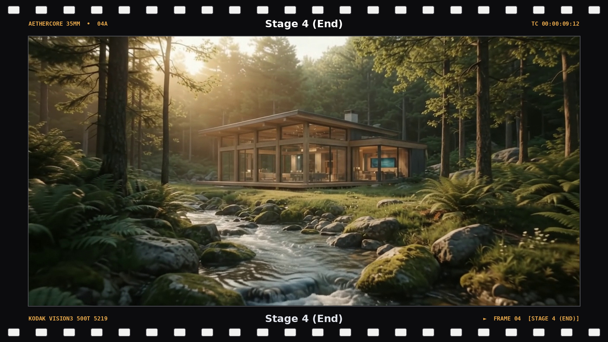

  <h1>🌲 AETHERCORE</h1>

  

    A 10-second cinematic video bridging computing and a forest habitat, illustrating their intersection and symbiosis.
  

<h2>📑 Table of Contents</h2>

<ul>
  <li><a href="#objective">Objective</a></li>
  <li><a href="#inspiration">Inspiration</a></li>
  <li><a href="#project-details">Project Details</a></li>
  <li><a href="#prompt">Prompt</a></li>
  <li><a href="#visual-narrative">Visual Narrative</a></li>
  <li><a href="#images">images</a></li>

</ul>

<h2 id="objective">🎯 Objective</h2>

  This project is a cinematic video that explores the 
  symbiosis between advanced technology and regenerative natural ecosystems. 
  The sequence features a continuous, 10-second camera pullback that starts from an extreme macro view 
  of a photonic processor chip. Then glides outward through a cabin to reveal 
  a pristine mountain stream and forest valley. Developed using Gemini iterative prompt engineering and video AI generation for a futuristic vision.

<h2 id="inspiration">🎬 Inspiration</h2>

<h3>Wired's I Saw the Face of God in a Semiconductor Factory</h3>

<table>
  <tr>
    <td>
      
    </td>
  </tr>
</table>

<a href="https://media.wired.com/clips/64184054b19ad4e3186e0677/master/pass/BF_WIRED_ANIMATION_FINALE_Backhannel.mp4">Watch Video</a>

<h2 id="project-details">🛠️ Project Details</h2>

  <strong>Tools:</strong> Gemini

  <strong>Model:</strong> Gemini 4 Argon (2026)

  <strong>Pipeline:</strong> Gemini → Google Veo

  <strong>Format:</strong> Video

<h2 id="prompt">⌨️ Prompt</h2>

  
<strong>View Video Prompt</strong>

  

    Cinematic documentary footage, 1080p resolution, 16:9 aspect ratio, 
    perfectly paced 10-second continuous slow-motion tracking shot, photorealistic. 
    The camera executes a seamless, fluid macro-to-wide spatial pullback across the 4-panel storyboard: 
    beginning with an extreme macro close-up focus on the AetherCore photonic micro-processor's intricate 
    silver circuit traces and glowing amber quartz crystals in the top-left panel; gliding smoothly and 
    deliberately backward through the warm mass-timber and architectural glass habitat structure in the top-right panel; 
    passing the massive floor-to-ceiling windows to reveal the interior living space in the bottom-left panel; 
    and finally transitioning entirely outside to a breathtaking, pristine view of the flowing mountain stream 
    and lush forest ecosystem under warm golden hour light in the bottom-right panel. 
    Absolute silence, zero-waste modern habitat harmony, consistent lighting, and rigorous structural 
    geometric integrity maintained throughout the entire continuous camera move.
  

  
<strong>View Images Prompt</strong>

  

Using screenshots extracted strictly from the uploaded video, generate four individual single-panel storyboard frames at 1080p resolution (1920x1080, 16:9 aspect ratio). Frame each screenshot inside a matte-black 35mm cinema border featuring white sprocket perforations along the top and bottom edges and amber monospace film-edge markings (stock code, timecode, and stage label in the bottom-right corner), with no centered white text: 

Stage 1 (Start): Extreme macro close-up focus on the AetherCore photonic micro-processor's intricate silver circuit traces and glowing amber/turquoise quartz pathways. 

Stage 2 (Transition): Mid-transition tracking shot gliding smoothly backward from the glass circuit table through the warm mass-timber and architectural glass structure. 

Stage 3 (Interior): Wide interior reveal passing the floor-to-ceiling glass windows to showcase the zero-waste living space and forest backdrop. 

Stage 4 (End): Pristine wide exterior view of the complete cabin nestled beside the flowing mountain stream and lush forest ecosystem under warm golden hour light. 

Export the 4 individual 1080p JPG files packaged together in a single ZIP archive.
  

<h2 id="visual-narrative">🎥 Visual Narrative</h2>

  To eliminate geometric warping and layout drift, the 10-second video is structured 
  around a 4-panel storyboard sequence:

<ul>
  <li><strong>Stage 1 (Start):</strong> Extreme macro close-up on the AetherCore micro-processor's intricate silver circuit traces, quartz crystals, and pulsing amber/turquoise light pathways.</li>
  <li><strong>Stage 2 (Transition):</strong> Mid-transition tracking shot gliding backward away from the chip table, revealing the warm interior depth of the mass-timber structure.</li>
  <li><strong>Stage 3 (Interior):</strong> Wide interior view showcasing the sleek zero-waste living space and floor-to-ceiling glass windows framing the forest outside.</li>
  <li><strong>Stage 4 (End):</strong> Pristine wide exterior shot looking back at the complete cabin nestled by a flowing mountain stream under golden hour light.</li>
</ul>

<table border="1" cellpadding="8" cellspacing="0" style="border-collapse: collapse; text-align: left; font-family: sans-serif;">
  <thead>
    <tr style="background-color: #f2f2f2;">
      <th>Stage</th>
      <th>Decimal Seconds</th>
      <th>Film Timecode (HH:MM:SS:FF)</th>
      <th>Frame Count (at 24 FPS)</th>
    </tr>
  </thead>
  <tbody>
    <tr>
      <td><strong>Stage 1 (Start)</strong></td>
      <td>0.2s</td>
      <td><code>00:00:00:05</code></td>
      <td>Frame 5</td>
    </tr>
    <tr>
      <td><strong>Stage 2 (Transition)</strong></td>
      <td>3.5s</td>
      <td><code>00:00:03:12</code></td>
      <td>Frame 84</td>
    </tr>
    <tr>
      <td><strong>Stage 3 (Interior)</strong></td>
      <td>6.0s</td>
      <td><code>00:00:06:00</code></td>
      <td>Frame 144</td>
    </tr>
    <tr>
      <td><strong>Stage 4 (End)</strong></td>
      <td>9.5s</td>
      <td><code>00:00:09:12</code></td>
      <td>Frame 228</td>
    </tr>
  </tbody>
</table>

<h2 id="video">🎥 Video</h2>

  <a href="https://redefiningvicky.github.io/My-Ecrin/">
    Watch Video
  </a>

<h2 id="Images">🎞️ Images </h2>

<h3>Stage 1 (Start)</h3>

<table>
  <tr>
    <td>
      
    </td>
  </tr>
</table>

<h3>Stage 2 (Transition)</h3>

<table>
  <tr>
    <td>
      
    </td>
  </tr>
</table>

<h3>Stage 3 (Interior)</h3>

<table>
  <tr>
    <td>
      
    </td>
  </tr>
</table>

<h3>Stage 4 (End)</h3>

<table>
  <tr>
    <td>
      
    </td>
  </tr>
</table>

  

    <a href="https://github.com/redefiningvicky/Generative-AI-Projects">
      Back to Generative AI Projects
    </a>
    &nbsp; • &nbsp;
    <a href="https://github.com/redefiningvicky/redefiningvicky">
      Back to Portfolio
    </a>
  

